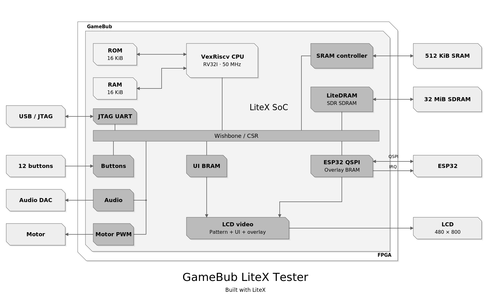

<!-- SPDX-License-Identifier: 0BSD -->

# GameBub LiteX

An experimental, open-source FPGA SoC and basic tester apps for the
**GameBub Rev4.x / XC7A100T-CSG324-1** handheld.

Gateware and firmware build with **Migen, LiteX, LiteDRAM, Yosys,
nextpnr/openXC7 and Project X-Ray**. Vivado was used only to program the
volatile FPGA image during the reported hardware tests, not for synthesis or
implementation. No AMD IP or Vitis software libraries are required by the demo.



## Working demo

The main example is [`examples/tester/`](examples/tester/README.md): a bare-metal VexRiscv
RV32I CPU, native LCD color patterns, a compact software UI, and five apps.

| App | Operation |
| --- | --- |
| Color | Cycle color bars and solid colors. |
| SRAM | Test a reserved 4 KiB scratch window in the 512 KiB SRAM. |
| SDRAM | Test a reserved 4 KiB scratch window in the 32 MiB SDR SDRAM. |
| Audio | Low-level 440 Hz stereo tone, hardware-limited to one second. |
| Vibration | 200 ms pulse, hardware-limited, with 20 kHz PWM. |

**Shoulders:** switch apps. **A:** start. **B:** stop.
The memory tests overwrite offsets `0x1000..0x1fff` in each external memory.

The ESP32 QSPI endpoint services the implemented buttons/IRQ/overlay subset.
Its black/white overlay has priority over a separate CPU-controlled UI buffer.
The CPU does not overwrite the ESP32 overlay memory. This is **not** complete
official core-framework compatibility, an SD-card explorer, or a Linux image.

## Start here

1. [Build and simulation instructions](docs/BUILD.md)
2. [Hardware results and limitations](docs/STATUS.md)
3. [Tester details and memory map](examples/tester/README.md)
4. [Licensing and provenance](LICENSE.md)
5. [Complete Rev4 pinout and interface coverage](docs/PINOUT.md)
6. [First tagged release checklist](docs/RELEASE_CHECKLIST.md)

After setting up the documented environment, generate the main example from
the repository root:

```bash
python examples/tester/generate.py --output "$PWD/build/tester-rtl-001"
```

The pinned environment is **Linux x86-64 / Ubuntu 22.04 / Python 3.10**;
WSL2 was used for the recorded builds. Tool archives and Python packages are
hash-pinned. This is an independent out-of-tree project, not an upstream
`litex-boards` release or a supported native Windows build.

## Hardware status

On **October 21, 2026**, the tester image was loaded and the user confirmed
the UI, shoulder navigation, and SRAM/SDRAM scratch-test PASS results.
Actual-CPU RTL simulation also exercised both memory-fault cases, LCD output,
QSPI traffic, digital audio, motor PWM and stop/timeout behavior.

**Experimental timing:** available open-source internal clock checks passed,
but external I/O setup/hold, CDC margins and qualified speed-grade/PVT timing
are **not signed off**. The memory tests are not full-capacity qualification.
Sound and motor movement have not separately been physically confirmed.
Do not treat this repository as a production-ready hardware guarantee.

Programming is always a separate, explicit step. These tools do not flash the
ESP32 or persistent FPGA storage. The installed ESP32 can replace a volatile
FPGA image if a game is launched from its menu.

## Source layout

- `examples/tester/`: the single main SoC example and five-app C firmware.
- `gamebub/`: reusable board, clocks, LCD, ESP32, memory and output peripherals.
- `tests/`: CPU/app, QSPI, clock, video, memory and portable source checks.
- `tools/`: pinned dependency bootstrap, implementation and JTAG helpers.
- `docs/`: architecture diagram, public instructions and acceptance summary.

Generated build trees and machine-specific logs are not published here.
Earlier layouts are available in Git history, not as competing examples.
No prebuilt release assets are included in this source tree.

Contributions follow [LiteX coding style](https://github.com/enjoy-digital/litex/blob/master/doc/coding_style.md);
see [CONTRIBUTING.md](CONTRIBUTING.md).

## License

This repository is **mixed-license**, not blanket 0BSD. Independent original
files marked 0BSD retain that license; GameBub-derived gateware, board bindings
and derived tester material retain CERN-OHL-S-2.0. The pinned official firmware
reference is GPL-3.0-only, and BSD-licensed components retain their notices.
See [LICENSE.md](LICENSE.md) and [`LICENSES/`](LICENSES/).

Independent community project; not an official GameBub, LiteX or AMD release.
